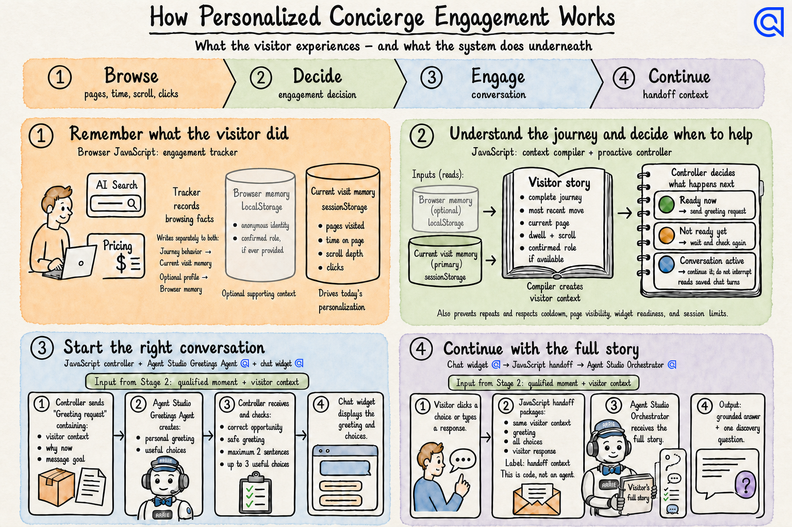

# Algolia Content Engagement - White Glove Concierge

This repository is the canonical source and operational home for the Algolia.com Content
Engagement concierge. It contains the source-built web component, Agent Studio configuration
and prompts, Jahia release tooling, visitor intelligence, validation evidence, and project
documentation.

Start here for the folder map and current runtime boundaries.

## Current Runtime

- Agent Studio app: `0EXRPAXB56`
- Primary development agent: `www Chat - Orchestrator`
- Retrieval index: `Algolia_Prod_Copy_Vanilla`
- Production Ask Algolia is read-only comparison evidence. Do not mutate it from this repo.
- Jahia development box: `https://tmp-content-eng-algolia.cloud.jahia.com/`

## Architecture

The full implementation walkthrough is in
[`docs/design/content-engagement-architecture.md`](docs/design/content-engagement-architecture.md).

The current source-reconciliation and design-separation program is in
[`docs/design/chat-architecture-reconciliation/MASTER-PLAN-2026-08-25.md`](docs/design/chat-architecture-reconciliation/MASTER-PLAN-2026-08-25.md).

The implemented source ownership and dependency boundaries are documented in
[`docs/architecture.md`](docs/architecture.md). Build, verification, release, and rollback
procedures are documented in [`docs/release.md`](docs/release.md).

### Personalized Concierge Engagement

[](docs/design/content-engagement-architecture.md#personalized-concierge)

### Asynchronous Judge Panel

[](docs/design/content-engagement-architecture.md#asynchronous-judge-panel)

## Folder Map

| Path | What lives there |
|---|---|
| `agents/prompts/` | Versioned prompt files and judge prompts that belong in Git. |
| `agents/admin/` | Agent Studio config builders and patch/provisioning scripts. |
| `agents/checks/` | Read-only live Agent Studio dump, spot-check, and sweep scripts. |
| `frontend/chat-widget/source/shared/` | Brand-neutral answer identity, evidence, lifecycle, and semantic placement contracts. |
| `frontend/chat-widget/source/algolia-com/code/` | Algolia runtime behavior, transport, context, proactive engagement, handoff, judges, telemetry, Compare, and persistence. |
| `frontend/chat-widget/source/algolia-com/presentation/` | Algolia presentation tokens, CSS, labels, motion, and responsive treatment. |
| `frontend/chat-widget/source/algolia-com/web-component/` | The public `<algolia-chat>` compatibility facade. |
| `frontend/chat-widget/` | Compatibility inputs, deterministic build configuration, release tests, and generated local `dist/` output. |
| `backend/jahia-modules/` | Jahia OSGi modules (Maven/Java) providing server-side endpoints for the chat widget, e.g. the token-telemetry API-key proxy. |
| `testing/` | Project-owned test contracts, journey definitions, manual test plans, automation specifications, and durable test summaries. |
| `skills/algolia-data-enrichment/` | Project-local enrichment skill, CLI, tests, references, and runbooks. |
| `tools/inspection/` | Small inspection/probe scripts used by workstream validation. |
| `config/` | Public configuration notes only. Secrets stay in ignored local env files. |
| `docs/customer-documentation/` | Narrative documentation chapters written for the project/customer record. |
| `docs/design/` | Durable architecture, design, and implementation contracts. |
| `docs/diagrams/` | Canonical architecture diagrams and their content contracts. |
| `docs/evidence/` | Compact validation evidence and reports that should remain reviewable in Git. |
| `docs/operations/` | Active operational packets and mutation evidence. Generated run payloads are ignored. |

## Important Boundaries

- `agents/checks/` replaced the old `agents/probes/` idea. These scripts inspect live systems; they are not prompt source.
- `agents/prompts/` replaced the old `agents/definitions/` naming. Prompts and judges belong here.
- `skills/algolia-data-enrichment/` is the project-local skill. Do not use a global `.claude/skills/algolia-data-enrichment` copy for this project.
- Canonical widget source lives under `frontend/chat-widget/source/`. Flat JavaScript files in `frontend/chat-widget/` remain compatibility and rollback inputs until every host uses the source-built bundle.
- Generated batches, caches, snapshots, and work queues are intentionally ignored and should not be committed.
- Start with `docs/design/content-engagement-architecture.md` for the end-to-end concierge and judge architecture.

## Common Commands

```bash
# Install and verify the canonical widget source and deterministic build
npm ci --prefix frontend/chat-widget
npm run verify

# Agent Studio inventory
node agents/admin/build_algolia_com_agents.mjs --list

# One live Agent Studio spot check
node agents/checks/spotcheck-live.mjs <agentId> "What is Algolia?"

# Enrichment CLI
PYTHONPATH=skills/algolia-data-enrichment/scripts \
python3 skills/algolia-data-enrichment/scripts/algolia_enrich.py <command> --workspace .
```

Before any Agent Studio or index mutation: snapshot the target, record rollback, dry-run where
possible, get approval when required, apply the smallest payload, read back, and save evidence.
