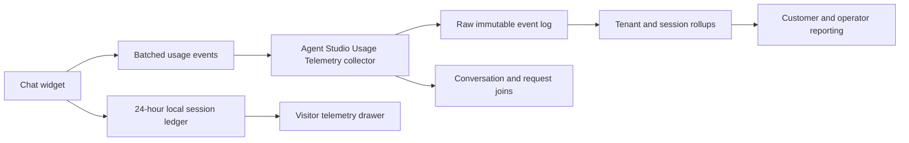

# Agent Studio Usage Telemetry

## The proposal in one sentence

Agent Studio should have its own usage telemetry pipeline. It should show what an agent did for
one visitor and also give the customer a correct total across every visitor, conversation, agent,
search request, model call, and cost.

This is not just a chat-widget feature. It is a product gap. Today, a customer can see the
conversation. They cannot clearly answer these basic questions:

- How many Algolia retrieval operations did this turn make?
- Which agent, tool, and index made them?
- How many input and output tokens did the agent use?
- What did that turn cost, and what has the whole conversation cost?
- Can the number in the user interface be checked against real requests and provider usage?

The proposed name is **Agent Studio Usage Telemetry**.

## Why a parallel pipeline

Algolia already has a proven event model. The [Insights API](https://www.algolia.com/doc/rest-api/insights/push-events)
accepts batches of user interaction events. Its supported event types are [click, conversion, and
view](https://www.algolia.com/doc/guides/sending-events/concepts/event-types). It is the right
place for those events.

It is not the right place to pretend that an LLM token or agent retrieval is a click. That would
make the data wrong, pollute search analytics, and bind a new product need to the wrong contract.

Agent Studio Usage Telemetry uses the same good ideas, in a separate pipeline:

- stable pseudonymous user identity;
- small batched events with an event ID for safe retries;
- request and correlation IDs for joining facts together;
- tenant and index boundaries on every event; and
- append-only raw events plus fast rollups.

The existing `userToken` pattern is a useful model because it identifies a user without sending
personal data to analytics. See [user tokens](https://www.algolia.com/doc/guides/sending-events/concepts/usertoken).

## What it measures

The first release measures two things. They stay separate, then appear together in the same view.

| Measure | Meaning | Unit of truth |
|---|---|---|
| Algolia retrieval usage | Every real request made to retrieve information for an agent turn | An observed request, not the number of source pills |
| LLM usage and cost | Tokens reported by the provider, or a clearly marked estimate | Provider usage frame or versioned estimator |

The system does **not** infer a search count from source pills. Source pills are display metadata
from results that already came back. They should not cause another query. The spike must prove this
with browser-network evidence.

Suggested follow-up questions get the same treatment. If Agent Studio creates them from the
current model response, there is no new Algolia retrieval. If it retrieves before creating them,
that real retrieval is counted.

## The product shape

There are two views of one event stream.

### Visitor telemetry drawer

The chat stays clean by default. A visitor can open a slide-in telemetry drawer when the product
chooses to expose it. The drawer is a personal receipt for the active session.

For each turn it shows:

- turn time and status;
- retrieval requests and billable operations, where that value is available;
- the agent, tool, phase, and index involved;
- input, output, cached, and reasoning tokens when supplied;
- a clear `reported` or `estimated` label for every token and cost value;
- estimated LLM cost and the stated Algolia pricing assumption; and
- running session and conversation totals.

The local ledger may remain open for 24 hours, so a person who returns to the same session keeps
the same running total.

### Customer and operator reporting

The server receives usage events for every client on approved product surfaces. Capture is not
controlled by whether the visitor opens the drawer. A customer or operator view uses the same data
to answer different questions:

- totals by tenant, day, model, agent, index, and tool;
- a single conversation or turn, reconstructed in order;
- failures, retries, cancellations, and cache outcomes;
- cost trends and outliers; and
- reconciliation against platform and provider evidence.

The visitor sees only their own session. The customer sees only their tenant. Algolia operators see
only the access their role allows.

## The event contract

The collector accepts a versioned batch endpoint, shaped like the familiar event API but separate
from Insights:

`POST /1/agent-usage/events`

One request carries 1 to 1,000 events. Each event has a unique `eventId`. The collector accepts a
safe repeat of the same event and stores it once.

Every event carries these common fields:

| Field | Why it exists |
|---|---|
| `schemaVersion`, `eventId`, `eventType`, `occurredAt` | Makes the contract durable and retry-safe |
| `appId`, `tenantId`, `indexName` | Keeps the data inside the right customer boundary |
| `userToken`, `visitorSessionId` | Separates a pseudonymous visitor from a 24-hour browser session |
| `conversationId`, `turnId`, `responseId`, `runId` | Joins the event to Agent Studio history and a visible answer |
| `parentEventId`, `attempt` | Explains retries and child work without double-counting |
| `agentKey`, `toolName`, `phase` | Says who did the work and why |
| `status`, `durationMs`, `errorCode` | Makes failures and latency visible |
| `privacyVersion`, `inputHash`, `outputHash` | Links work without copying raw conversation text |

The initial event types are:

| Event type | When it is sent |
|---|---|
| `agent_turn_started` | A visitor or proactive workflow starts a turn |
| `algolia_retrieval_observed` | A real agent retrieval request starts or completes |
| `algolia_api_request_observed` | A non-retrieval Algolia call needs separate accounting |
| `llm_completion_observed` | A model completion starts or completes |
| `llm_usage_reported` | The provider returns actual token usage |
| `llm_usage_estimated` | The system calculates a documented estimate instead |
| `agent_turn_completed` | The user-visible result finishes, fails, or is cancelled |
| `telemetry_delivery_failed` | The client cannot deliver a batch after retries |

Retrieval events include request ID, correlation ID, query ID where present, index, request-shape
hash, result count, cache state, retry relationship, outcome, and billable-operation count when the
platform exposes it. Algolia's Search API documents both a response `Correlation-ID` and an
optional client-supplied `Request-ID`; those identifiers make later reconciliation practical. See
the [Search API reference](https://www.algolia.com/doc/rest-api/search).

LLM events include provider, model, model version, input/output/cached/reasoning tokens, pricing
registry version, currency, and cost. A value is always labelled `reported` or `estimated`; the UI
never makes an estimate look like a provider invoice.

## Client behavior

The client has three jobs:

1. Observe the work it starts and the usage frames it receives from Agent Studio.
2. Update the local 24-hour session ledger immediately, so the drawer is useful before a network
   round trip completes.
3. Send redacted, retry-safe batches at turn completion, at a short interval, and when the page is
   hidden. It uses a background-safe delivery method in the last case.

The client must not use the IP address as the session key. IP addresses change, may be shared by
many people, and create unnecessary privacy risk. A randomly generated `visitorSessionId`, held in
the browser for 24 hours, is the right session boundary. A stable pseudonymous `userToken` can link
sessions when the product legitimately has one.

## Server behavior

The server is the system of record. It validates the schema, authenticates the tenant, removes
duplicates by `eventId`, stores raw events, and builds rollups.

The raw log is needed for investigation and replay. Rollups make normal reporting fast. At minimum,
the collector maintains totals by tenant/day, visitor session/conversation, turn, agent/tool/phase,
index/model, status/retry/cache, and price-registry version.

The collector links to Agent Studio conversation history by ID. It does not become a second copy of
the conversation transcript. The transcript remains where Agent Studio already owns it; the usage
system stores identifiers, hashes, and measurements.

## Pricing and reconciliation

Measured use and price assumptions are deliberately separate.

- Model prices live in a versioned registry with effective dates and source links.
- Algolia pricing assumptions live in a separate versioned registry. They can be absent when a
  customer contract makes a per-operation price unknowable.
- A retry is a real extra attempt and is shown as one; it is never silently folded away.
- Cached work, cancelled work, and failed work are retained with their actual outcome.
- Reporting compares telemetry totals with available search and provider records. Algolia's
  [Usage API](https://www.algolia.com/doc/rest-api/usage) is useful for app-level reconciliation,
  but it is a reporting source, not the event collector.

## Privacy, access, and retention

This is usage telemetry, not a second surveillance product.

- No raw prompt, answer, IP address, email address, or user profile goes to the shared collector by
  default.
- The drawer can render the current visitor's own readable turn data from its local ledger.
- Server-side joins use IDs and hashes. Storing text later needs a separate retention and consent
  decision.
- Tenant boundaries, role-based access, retention windows, deletion behavior, and audit access are
  product requirements, not deployment details.

## What the Algolia.com spike proves

The spike is the first working proof of this product proposal. It proves the event contract and the
two user experiences without pretending that a prototype is already a global telemetry service.

It must prove, with tests and browser/network evidence, that:

- source pills do not make another Algolia request;
- follow-up suggestions are counted only when they really retrieve;
- primary, Person, specialist, and judge work can be distinguished;
- parallel work, retries, cache hits, failures, cancellations, resets, and long conversations
  reconcile without double-counting;
- provider token values are preserved when available and estimates are visibly labelled when not;
- the drawer's turn totals equal the collector's turn totals; and
- collector aggregates can be checked against request and provider evidence.

This is the shared foundation for Asana 2.2, 2.3, and 2.4. Grounding judges are deliberately not
part of the first implementation slice, but the event contract already has the fields needed to
measure them when that work begins.

## Decisions made in this proposal

1. Build a separate Agent Studio Usage Telemetry pipeline; do not send fabricated usage events to
   the existing Insights endpoint.
2. Capture usage for every client on approved product surfaces, whether or not the visitor opens
   the telemetry drawer.
3. Use a client ledger plus a server collector. The local ledger is for the visitor; the server is
   for durable tenant-wide accounting.
4. Use a 24-hour pseudonymous browser session, not an IP address, as the session boundary.
5. Send continuously in small retry-safe batches. Do not wait until the end of 24 hours and risk
   losing the data.
6. Treat direct provider usage as the best value; label estimates clearly and retain the price
   registry version that created each cost.
7. Keep raw conversation text out of the shared usage pipeline by default.

## R&D ask

Treat Agent Studio Usage Telemetry as a platform capability, not a widget-only feature. The
Algolia.com spike can supply a live reference implementation, concrete event examples, a telemetry
drawer, reconciliation tests, and evidence of the customer questions it answers.

The product decision for R&D is whether to make this a first-class Agent Studio API and reporting
surface, so every Agent Studio customer can understand the retrieval and model economics behind
every answer.
