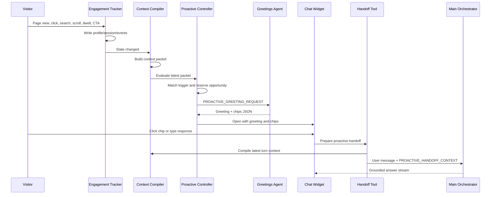

# Proactive Engagement Flow

## What We Built

The proactive engagement flow lets the Algolia.com demo concierge observe a visitor's current session, compile a safe context packet, decide when a timely interruption is justified, ask an Agent Studio Greetings Agent for a sharp personalized greeting, and carry the first engaged turn into the main `www Chat - Orchestrator`.

The browser controls timing. Agent Studio controls language and conversation quality.

## Runtime Components

| Stage | File or agent | Role |
|---|---|---|
| Collector | `frontend/chat-widget/algolia-engagement-tracker.js` | Captures browser behavior and writes structured profile, session, and event state. |
| Compiler | `frontend/chat-widget/algolia-context-compiler.js` | Flattens tracker state into `AlgoliaContextPacket.v1` and `AlgoliaTurnContext.v1`. |
| Controller | `frontend/chat-widget/algolia-proactive-controller.js` | Evaluates journey triggers, reserves an opportunity, calls the Greetings Agent, and asks the chat widget to render the returned greeting. |
| Greetings Agent | `www Chat - Proactive Concierge`; prompt in `agents/prompts/instructions_algolia_proactive_greeting.md` | Creates one greeting and up to three chips from the proactive packet. It does not continue the full answer conversation. |
| Handoff tool | `frontend/chat-widget/handoff-to-orchestrator.js` | Registers `handoff_to_orchestrator`, captures the selected chip or typed response, and attaches the proactive handoff context to the next orchestrator turn. |
| Main Orchestrator | `www Chat - Orchestrator`; prompt in `agents/prompts/instructions_algolia_orchestrator.md` | Answers the visitor using the normal grounded answer flow, now aware of the proactive moment that started the conversation. |

## Storage Contract

| Key | Storage | Contents |
|---|---|---|
| `algolia_profile` | `localStorage` | Visitor-level state that can survive refreshes, such as selected demo persona and durable preferences. |
| `algolia_session` | `sessionStorage` | Current-tab journey state: pages, dwell, scroll, referrer, engagement history, and latest proactive opportunity. |
| `algolia_events` | `sessionStorage` | Bounded ordered event stream: page views, nav clicks, CTA clicks, searches, form starts, scroll milestones, dwell milestones, and chat interactions. |
| `algolia_proactive_state` | `sessionStorage` | Controller-owned opportunity records, cooldown state, and handoff status. |

Hover is not an intent event and must not open the chat. The tracker may observe UI interactions, but proactive triggers require stronger signals such as page view, click, search, dwell, scroll, or a journey shift.

## Flow



## Trigger Model

The controller evaluates deterministic journey moments. Examples include:

| Moment | Example triggers | Goal |
|---|---|---|
| Product research | Product page dwell or 50% scroll; multiple product pages | Help compare capabilities and clarify fit. |
| Implementation research | Developer/docs dwell, 60% scroll, or search-to-docs path | Reduce implementation uncertainty. |
| Commercial evaluation | Product-to-pricing, implementation-to-pricing, or pricing dwell | Explain cost drivers and connect effort to value. |
| Customer proof | Product-to-customer-story or customer-story dwell/scroll | Surface relevant customer proof. |
| Journey shift | Repeated movement between technical and commercial pages | Help the visitor resolve the real tradeoff behind the path. |

The controller owns the trigger decision. The Greetings Agent receives the selected moment, trigger, goal, persona, current page, journey, observed signals, inferred intent, and friction.

## Greeting Contract

The Greetings Agent receives `PROACTIVE_GREETING_REQUEST` and returns strict `ProactiveGreetingResponse.v1` JSON:

```json
{
  "schema": "ProactiveGreetingResponse.v1",
  "opportunityId": "opp_...",
  "greeting": "Pricing pages are where good search ideas meet budget gravity. Want the practical version of what actually drives cost?",
  "chips": ["What drives cost?", "How are API calls counted?", "Which plan fits?"],
  "handoffSummary": {
    "moment": "commercial_evaluation",
    "trigger": "product_to_pricing",
    "messageGoal": "explain_cost_drivers"
  }
}
```

The JSON is a runtime contract, not the visible UI. The visitor sees the greeting text and chips. The greeting must be useful, specific, concise, and lively without exposing telemetry.

## Handoff Contract

After the visitor engages, the handoff tool attaches `PROACTIVE_HANDOFF_CONTEXT` to the next main orchestrator request. The context includes:

- original opportunity ID;
- greeting shown;
- chips shown;
- selected chip, if any;
- typed response, if any;
- handoff summary;
- original proactive request packet;
- latest compiled context packet and turn context.

The orchestrator treats this as context only. It answers the visitor's actual message first, searches before making factual Algolia claims, and never exposes hidden telemetry or handoff internals.

## Current Status

Completed and deployed to the Jahia development site:

- tracker;
- context compiler;
- proactive controller;
- Greetings Agent prompt;
- Greetings Agent client-side tool schema;
- Greetings Agent guardrails, cost controls, and rate controls;
- handoff runtime;
- orchestrator prompt support for proactive handoff context.

The remaining work is end-to-end product tuning: sharper greeting samples, full trigger permutation QA, and final orchestration behavior once the user engages.
