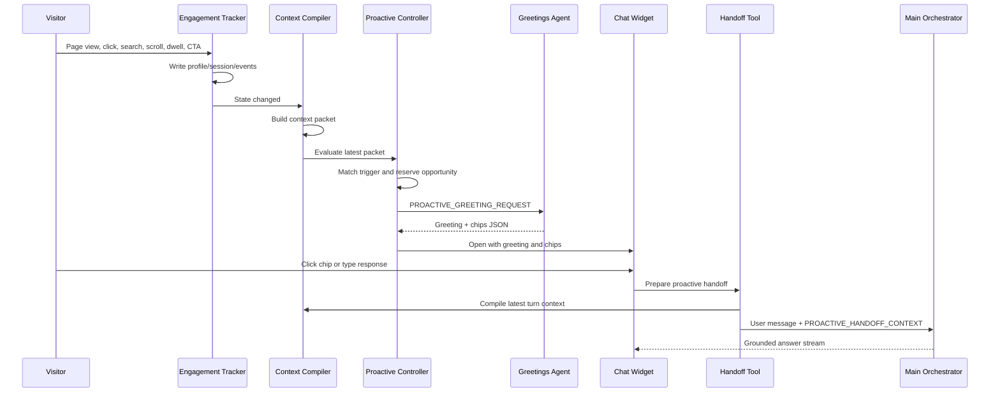

# Proactive Engagement Flow

## What We Built

The proactive engagement flow lets the Algolia.com demo concierge observe a visitor's current session, compile a safe context packet, decide when a timely interruption is justified, ask an Agent Studio Greetings Agent for a sharp personalized greeting, and carry the first engaged turn into the main `www Chat - Orchestrator`.

The browser controls timing. Agent Studio controls language and conversation quality.

## Runtime Components

| Stage | File or agent | Role |
|---|---|---|
| Collector | `frontend/chat-widget/algolia-engagement-tracker.js` | Captures browser behavior and writes structured profile, session, event, and product-focus state. |
| Compiler | `frontend/chat-widget/algolia-context-compiler.js` | Builds the rich browser packet and a bounded `AlgoliaTurnContext.v1` for Agent Studio. The turn context contains qualified journey summaries, not the raw event stream. |
| Controller | `frontend/chat-widget/algolia-proactive-controller.js` | Evaluates journey triggers, reserves an opportunity, adds contextual focus for personalization, calls the Greetings Agent, and asks the chat widget to render the returned greeting. |
| Greetings Agent | `www Chat - Proactive Concierge`; prompt in `agents/prompts/instructions_algolia_proactive_greeting.md` | Creates one greeting and up to three chips from the proactive packet. It does not continue the full answer conversation. |
| Handoff tool | `frontend/chat-widget/handoff-to-orchestrator.js` | Registers `handoff_to_orchestrator`, captures the selected chip or typed response, and attaches the proactive handoff context to the next orchestrator turn. |
| Main Orchestrator | `www Chat - Orchestrator`; prompt in `agents/prompts/instructions_algolia_orchestrator.md` | Answers the visitor using the normal grounded answer flow, now aware of the proactive moment that started the conversation. |

## Storage Contract

| Key | Storage | Contents |
|---|---|---|
| `algolia_profile` | `localStorage` | Visitor-level state that can survive refreshes, such as selected demo persona and durable preferences. |
| `algolia_session` | `sessionStorage` | Current-tab journey state: pages, dwell, scroll, referrer, engagement history, and latest proactive opportunity. |
| `algolia_events` | `sessionStorage` | Bounded ordered event stream: page views, nav clicks, CTA clicks, searches, form starts, scroll milestones, dwell milestones, and chat interactions. |
| `algolia_proactive_state` | `sessionStorage` | Controller-owned opportunity records, cooldown state, and handoff status. |
| `algolia-chat:handoff-context` | `sessionStorage` | Compact original proactive greeting context retained for later orchestrator turns in the same tab. |

Hover is not an intent event and must not open the chat. The tracker may observe UI interactions, but proactive triggers require stronger signals such as page view, click, search, dwell, scroll, or a journey shift.

For demo QA, `?algoliaProactiveReset=1` clears session-scoped proactive state, events, and session history without deleting `algolia_profile`. This gives a clean tab journey while preserving durable profile/persona behavior.

## Flow



## Trigger Model

The controller evaluates deterministic page and transition moments:

| Moment | Example triggers | Goal |
|---|---|---|
| Product research | Product page reaches 3 seconds and 30% scroll | Help clarify the current capability and its fit. |
| Solution research | Solution page reaches 3 seconds and 30% scroll | Connect an industry or use-case need to an outcome. |
| Technical progression | Qualified product page followed by the same-origin documentation route | Carry product interest into implementation guidance. |
| Customer proof | Qualified solution page followed by a customer story | Connect the business need to grounded proof. |
| Commercial evaluation | Qualified product or solution page followed by Pricing | Explain cost and value in the context of the preceding research. |

The controller owns the trigger decision. The Greetings Agent receives the selected moment, trigger, goal, persona, current page, canonical `journeyContext`, raw journey, observed signals, inferred intent, friction, and `contextualFocus`.

`contextualFocus` is the most specific observed product or feature context available. On a product page it comes from the current page. On a follow-on commercial page, such as Product → Pricing, it comes from the prior product page. For example, `/products/features/personalization` followed by `/pricing` sends `contextualFocus.label = "Personalization"` so the greeting can talk about Personalization value and cost instead of generic pricing.

`journeyContext` is the single story contract for personalization. It contains the qualified immediate `origin`, current `destination`, `currentNavigationEdge`, a bounded `broaderJourney` with product, solution, and page trails, and a safe internal `journeyNarrativeHint`. For example, Search → Personalization → AI Recommendations → Pricing sends Pricing as the destination, AI Recommendations as the immediate origin, all three product interests in the broader trail, and framing guidance for a cross-capability cost/value question. The visitor should not hear the raw path narrated back; the greeting should translate the pattern into a useful hook.

In debug mode, `?algoliaProactiveDebug=1` exposes the latest suppression reason in `window.__algoliaProactiveLastSuppression`, dispatches `algolia-proactive-suppressed`, and displays a small debug status badge when the DOM is available. This makes invisible blocks such as `chat_already_open`, `cooldown_active`, or `already_eligible_for_page_moment` observable during QA.

Opportunity lifecycle matters. `eligible`, `greeting_requested`, `greeting_failed`, `greeting_rejected`, `widget_unavailable`, and `render_refused` are diagnostic states only. They do not count toward the session cap and do not start cooldown because the visitor has not seen an engagement. Cooldown and cap are based on visible states such as `shown` and handoff states. This prevents an invisible, cancelled, or failed greeting request from blocking a later, higher-value journey moment.

## Greeting Contract

The Greetings Agent receives `PROACTIVE_GREETING_REQUEST` and returns strict `ProactiveGreetingResponse.v1` JSON:

```json
{
  "schema": "ProactiveGreetingResponse.v1",
  "opportunityId": "opp_...",
  "greeting": "Hey there, explorer. If AI Search, Personalization, and Recommendations are all on your radar, you are circling powerful but different jobs. I can help compare the tradeoffs, find real customer examples, or go deeper on the angle that matters most.",
  "chips": ["Show customer examples", "Compare the options", "Go deeper"],
  "handoffSummary": {
    "moment": "commercial_evaluation",
    "trigger": "product_to_pricing",
    "messageGoal": "explain_cost_drivers"
  }
}
```

The JSON is a runtime contract, not the visible UI. The visitor sees the greeting text and chips. The greeting should feel like white-glove concierge attention: warm, specific, directional, autonomy-preserving, and lively without exposing telemetry. The greeting can offer customer examples, comparison, or deeper exploration, but it must not invent numeric proof claims.

## Handoff Contract

After the visitor engages, the handoff runtime attaches `PROACTIVE_HANDOFF_CONTEXT` to the next main orchestrator request. The compact context includes:

- original opportunity ID;
- greeting shown;
- chips shown;
- selected chip, if any;
- typed response, if any;
- handoff summary;
- a bounded request summary containing the moment, trigger, current focus, and compact journey summary;
- the original flat turn context used for the greeting.

The compact handoff is retained in `sessionStorage`. On each later visitor turn, the runtime reattaches the original handoff and compiles a fresh flat turn context for the visitor's current page. The orchestrator therefore keeps the origin story without answering stale chip text or losing later navigation context.

`AlgoliaTurnContext.v1` is validated before any network request: at most 32 keys, 4,096 total bytes, and 1,024 bytes per value. An invalid field blocks the request, records its exact field and byte count for debugging, and leaves the opportunity available for retry. Values are never silently clipped or discarded.

## Current Status

Completed and deployed to the Jahia development site:

- tracker;
- context compiler;
- proactive controller;
- Greetings Agent prompt;
- Greetings Agent client-side tool schema;
- Greetings Agent guardrails, cost controls, and rate controls;
- handoff runtime;
- orchestrator prompt support for proactive handoff context.

The remaining work is end-to-end product tuning: sharper greeting samples, full trigger permutation QA, and final orchestration behavior once the user engages.
