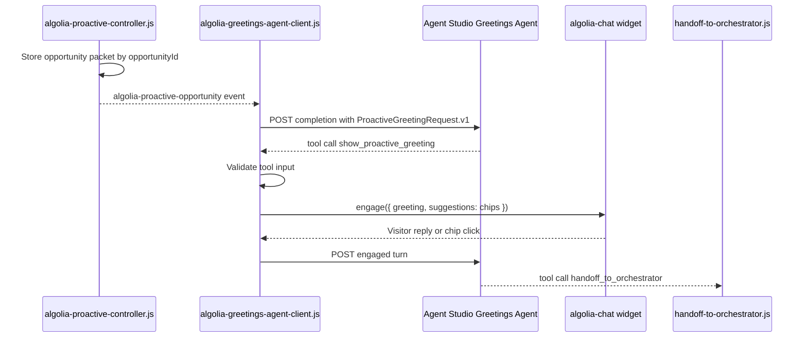

# Algolia Greetings Agent Client

## Purpose

`algolia-greetings-agent-client.js` is the browser module that connects proactive controller opportunities to the Agent Studio Greetings Agent.

It does not decide triggers, write greeting copy, or hand off to the main orchestrator. It calls the Greetings Agent, executes the `show_proactive_greeting` client-side tool, validates the tool input, and renders the greeting/chips in the chat widget.

## Position In Flow



## Inputs

The client listens for `algolia-proactive-opportunity` from `algolia-proactive-controller.js`.

Expected event detail:

```json
{
  "schema": "AlgoliaProactiveDecision.v1",
  "opportunityId": "opp_...",
  "moment": "commercial_evaluation",
  "trigger": "product_to_pricing",
  "messageGoal": "explain_cost_drivers",
  "agentPromptPacket": {
    "schema": "ProactiveGreetingRequest.v1"
  }
}
```

The controller must already have stored the full immutable opportunity packet in session storage.

## Configuration

The module reads:

```js
window.ALGOLIA_GREETINGS_AGENT_CONFIG = {
  appId: "0EXRPAXB56",
  apiKey: "<search-only key>",
  greetingsAgentId: "<Agent Studio Greetings Agent ID>",
  compatibilityMode: "ai-sdk-5",
  timeoutMs: 12000,
  debug: false
};
```

It may also read matching attributes from a future host element, but window config is enough for v1.

## Completion Request

The client POSTs to:

```text
https://{appId}.algolia.net/agent-studio/1/agents/{greetingsAgentId}/completions?compatibilityMode=ai-sdk-5&stream=true&cache=false&memory=false
```

Request body:

```json
{
  "id": "alg_cnv_proactive_opp_...",
  "messages": [
    {
      "id": "alg_msg_proactive_opp_...",
      "role": "user",
      "parts": [
        {
          "type": "text",
          "text": "PROACTIVE_GREETING_REQUEST\n{...ProactiveGreetingRequest.v1...}"
        }
      ],
      "metadata": {
        "turnContext": {
          "schema": "AlgoliaTurnContext.v1"
        }
      }
    }
  ]
}
```

## Tool Handling

The module handles the Agent Studio client-side tool `show_proactive_greeting`.

Agent Studio tool schema:

```json
{
  "type": "function",
  "function": {
    "name": "show_proactive_greeting",
    "description": "Render the proactive greeting and optional chips in the Algolia.com chat widget. Use this on the first proactive greeting turn after reading the opportunity packet. Do not answer the visitor directly.",
    "strict": true,
    "parameters": {
      "type": "object",
      "properties": {
        "schema": {
          "type": "string",
          "enum": ["ShowProactiveGreeting.v1"]
        },
        "opportunityId": {
          "type": "string",
          "description": "The proactive opportunity identifier from the original request."
        },
        "greeting": {
          "type": "string",
          "description": "The 12-34 word proactive greeting to show."
        },
        "chips": {
          "type": "array",
          "description": "Optional follow-up chips shown below the greeting.",
          "items": { "type": "string" },
          "maxItems": 3
        },
        "handoffSummary": {
          "type": "object",
          "properties": {
            "moment": { "type": "string" },
            "trigger": { "type": "string" },
            "messageGoal": { "type": "string" }
          },
          "required": ["moment", "trigger", "messageGoal"],
          "additionalProperties": false
        }
      },
      "required": ["schema", "opportunityId", "greeting", "chips", "handoffSummary"],
      "additionalProperties": false
    }
  }
}
```

Tool input schema:

```json
{
  "schema": "ShowProactiveGreeting.v1",
  "opportunityId": "opp_...",
  "greeting": "Pricing pages are where good search ideas meet CFO gravity. Want the practical version of what actually drives cost?",
  "chips": ["What drives cost?", "Which plan fits?"],
  "handoffSummary": {
    "moment": "commercial_evaluation",
    "trigger": "product_to_pricing",
    "messageGoal": "explain_cost_drivers"
  }
}
```

Validation gates:

- `schema` equals `ShowProactiveGreeting.v1`.
- `opportunityId` matches a stored, unexpired opportunity.
- `greeting` is 12-34 words.
- `chips` has at most 3 items, each 8 words or fewer.
- `handoffSummary` matches the stored opportunity.
- Greeting does not expose telemetry or raw behavior.
- Greeting does not include unsupported claims, URLs, pricing values, customer metrics, or hidden/internal language.

On pass, call:

```js
document.querySelector("algolia-chat")?.engage({
  greeting,
  suggestions: chips
});
```

Then write an engagement-history entry through `algolia-engagement-tracker.js`.

## Engaged Turn

When the user replies or clicks a chip, this module sends a second completion request to the Greetings Agent. That request includes:

- the visitor's exact reply or selected chip;
- `opportunityId`;
- the rendered greeting;
- the original `handoffSummary`;
- latest `AlgoliaTurnContext.v1` metadata.

The Greetings Agent must then call `handoff_to_orchestrator`. If it returns text instead, the client treats that as invalid behavior and does not show it as the final answer.

## Failure Behavior

| Failure | Behavior |
|---|---|
| Missing config | Do nothing; log in debug mode. |
| Agent call fails | Do not open widget; mark opportunity failed. |
| Tool input invalid | Do not open widget; log validation reason. |
| Widget unavailable | Store pending greeting until widget is ready or TTL expires. |
| Opportunity expired | Do not open widget. |

## Tests

Unit tests must prove:

- It listens to `algolia-proactive-opportunity`.
- It posts a completion request to the configured Greetings Agent.
- It handles `show_proactive_greeting`.
- It refuses invalid greeting length, telemetry leakage, mismatched opportunity, and too many chips.
- It calls `algolia-chat.engage` only after validation passes.
- It records engagement exposure.
- It does not call the orchestrator directly.

## Documentation Evidence

This design follows Algolia Agent Studio's client-side tool model: tools are defined in Agent Studio and executed by frontend or backend code, and can trigger UI updates or app actions.
