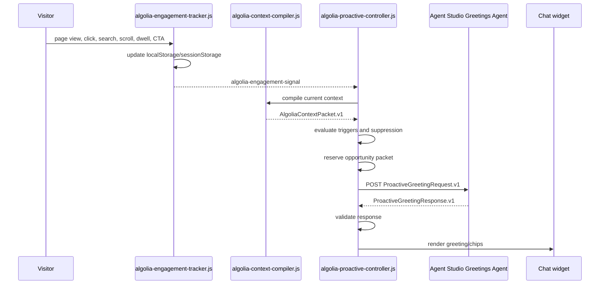

# Algolia Proactive Controller

## Purpose

The proactive controller decides when the concierge has earned the right to interrupt and sends the qualified opportunity packet to the Agent Studio Greetings Agent.

It does not write greeting copy, search Algolia, render UI, or call the main orchestrator. Its job is to read the visitor context packet, evaluate deterministic journey triggers, reserve one eligible opportunity, POST the packet to the Greetings Agent, validate the greeting response, and ask the chat widget to open with that returned greeting.

Agent Studio owns the greeting language. The browser controller owns timing and validation. The chat widget owns rendering and the eventual orchestrator conversation.

## Runtime Files

| Layer | File | Responsibility |
|---|---|---|
| Collector | `frontend/chat-widget/algolia-engagement-tracker.js` | Captures page views, clicks, searches, scroll, dwell, CTA/form signals, persona selection, and chat interactions. |
| Compiler | `frontend/chat-widget/algolia-context-compiler.js` | Compiles tracker state into `AlgoliaContextPacket.v1` and Agent Studio `metadata.turnContext`. |
| Controller | `frontend/chat-widget/algolia-proactive-controller.js` | Evaluates trigger grammar, stores opportunity packets, POSTs to the Greetings Agent, validates its response, and opens the widget. |
| Handoff client tool | `frontend/chat-widget/handoff-to-orchestrator.js` | Registers `handoff_to_orchestrator` and attaches the proactive handoff packet to the next primary orchestrator turn after the visitor engages. |
| Engage shell | `frontend/chat-widget/algolia-chat-engage.js` | Visual acknowledgement and existing widget integration. |

## Storage Contract

The controller reads existing tracker/compiler state and writes only its own opportunity state.

| Key | Storage | Owner | Notes |
|---|---|---|---|
| `algolia_profile` | `localStorage` | Tracker | Visitor-level profile such as selected persona. Survives refreshes. |
| `algolia_session` | `sessionStorage` | Tracker | Current session pages, dwell, scroll, and engagement history. |
| `algolia_events` | `sessionStorage` | Tracker | Bounded event stream for this browser tab session. |
| `algolia_proactive_state` | `sessionStorage` | Controller | Reserved proactive opportunities and cooldown state. |
| `algolia_proactive_debug_log` | `sessionStorage` | Controller | Debug-only pipeline trace when `algoliaProactiveDebug=1` or `algoliaChatDebug=1` is present. |

## Trigger Grammar

The controller evaluates candidates in priority order and selects the highest eligible trigger.

| Moment | Trigger | Condition | Priority | Message goal |
|---|---|---|---:|---|
| Commercial evaluation | `product_to_pricing` | Current page is pricing/demo/contact and a prior session page was product. | 88 | `explain_cost_drivers` |
| Commercial evaluation | `solution_to_pricing` | Current page is pricing/demo/contact and a prior session page was solution/industry. | 87 | `explain_solution_value_and_cost` |
| Commercial evaluation | `implementation_to_pricing` | Current page is pricing/demo/contact and a prior page was developer/docs. | 86 | `connect_implementation_effort_to_cost` |
| Implementation research | `pricing_to_implementation` | Current page is developer/docs and a prior page was pricing/demo/contact. | 84 | `reduce_implementation_uncertainty` |
| Customer proof | `product_to_customer_story` | Current page is a customer story and a prior page was product. | 82 | `surface_relevant_customer_proof` |
| Customer proof | `solution_to_customer_story` | Current page is a customer story and a prior page was solution/industry. | 81 | `surface_relevant_customer_proof` |
| Implementation research | `search_to_docs` | Current page is developer/docs and recent site search included implementation terms. | 80 | `answer_implementation_path` |
| Commercial evaluation | `pricing_8s_dwell` | Current page is pricing/demo/contact after a qualifying source page reached 5 seconds dwell and 25% scroll. | 78 | `explain_cost_drivers` |
| Implementation research | `developer_page_5s_25_scroll` | Current page is developer/docs with at least 5 seconds dwell and 25% scroll. | 76 | `reduce_implementation_uncertainty` |
| Customer proof | `solution_to_customer_story` | Current page is a customer story with at least 5 seconds dwell and 25% scroll after a qualifying solution page. | 72 | `surface_relevant_customer_proof` |
| Product research | `product_page_5s_25_scroll` | Current page is product with at least 5 seconds dwell and 25% scroll. | 66 | `explain_product_fit` |
| Solution research | `solution_page_5s_25_scroll` | Current page is solution/industry with at least 5 seconds dwell and 25% scroll. | 65 | `explain_solution_fit` |
| Journey shift | `multiple_product_pages` | Session includes at least two product pages. | 62 | `help_compare_capabilities` |
| Journey shift | `multiple_solution_pages` | Session includes at least two solution/industry pages. | 61 | `help_compare_solution_paths` |

Hover is not a proactive trigger. Hover can help the UI expose menus, but it is too weak to infer intent or open a concierge message.

## Suppression Rules

An eligible trigger is suppressed when:

| Reason | Meaning |
|---|---|
| `disabled` | Controller config disables proactive engagement. |
| `missing_context_packet` | The context compiler is not available. |
| `no_trigger_match` | No trigger matched the current packet. |
| `chat_already_open` | The visitor recently opened the chat. |
| `page_hidden` | The browser page is not visible. |
| `auto_engage_disabled` | The chat component explicitly disables auto engagement. |
| `session_cap_reached` | The session already used the configured opportunity cap. |
| `cooldown_active` | A prior opportunity was reserved too recently. |
| `already_eligible_for_page_moment` | The same page and moment already has an active opportunity. |

Defaults:

```json
{
  "maxOpportunitiesPerSession": 3,
  "cooldownMs": 120000,
  "productDwellMs": 5000,
  "productScrollDepth": 25,
  "solutionDwellMs": 5000,
  "solutionScrollDepth": 25,
  "documentationJourneyDwellMs": 5000,
  "documentationJourneyScrollDepth": 25,
  "proofJourneyDwellMs": 5000,
  "proofJourneyScrollDepth": 25,
  "implementationDwellMs": 5000,
  "implementationScrollDepth": 25,
  "resourceDwellMs": 5000,
  "resourceScrollDepth": 25
}
```

Greetings Agent configuration:

```js
window.ALGOLIA_PROACTIVE_CONFIG = {
  greetingsAgentId: "<Agent Studio Greetings Agent ID>",
  appId: "0EXRPAXB56",
  apiKey: "<search-only key>",
  compatibilityMode: "ai-sdk-5",
  cache: false,
  memory: false
};
```

On the Jahia demo surface, the controller also accepts the existing
`<algolia-chat-engage concierge-agent-id="...">` DOM attribute and
`window.ALGOLIA_CONTEXT_ENGINE_CONFIG.conciergeAgentId` as fallback Greetings
Agent IDs. The DOM attribute is important because the controller can load before
`algolia-chat-engage.js` has written the global config. Product-to-pricing and
solution-to-pricing page-view triggers depend on this startup path.

## Decision Packet

When a trigger is eligible, the controller generates an `opportunityId` and builds:

```json
{
  "schema": "AlgoliaProactiveDecision.v1",
  "engage": true,
  "opportunityId": "opp_19fff074c5d_23ee98",
  "moment": "commercial_evaluation",
  "trigger": "product_to_pricing",
  "priority": 88,
  "messageGoal": "explain_cost_drivers",
  "reasonCodes": ["journey_product_to_pricing", "pricing_page_view"],
  "agentPromptPacket": {
    "schema": "ProactiveGreetingRequest.v1",
    "opportunityId": "opp_19fff074c5d_23ee98",
    "moment": "commercial_evaluation",
    "trigger": "product_to_pricing",
    "priority": 88,
    "persona": "developer",
    "currentPage": {},
    "journey": [],
    "observedSignals": [],
    "inferredIntent": {},
    "friction": {},
    "messageGoal": "explain_cost_drivers",
    "tone": "sharp, useful, warm, lightly witty",
    "constraints": {
      "noTelemetryExposure": true,
      "includeQuestionChips": true
    }
  }
}
```

Downstream greeting generation should use this packet as input. The greeting must never expose raw telemetry such as “I saw you click X.” It should translate the moment into useful concierge help.

The full `agentPromptPacket` is stored in `sessionStorage.algolia_proactive_state` under the generated `opportunityId`. `handoff-to-orchestrator.js` later reads the same packet for downstream orchestrator handoff.

## Greetings Agent Call

After reserving an eligible opportunity, the controller calls the Agent Studio Greetings Agent directly.

POST:

```text
https://{appId}.algolia.net/agent-studio/1/agents/{greetingsAgentId}/completions?compatibilityMode=ai-sdk-5&stream=false&cache=false&memory=false
```

Body:

```json
{
  "id": "alg_cnv_proactive_opp_19fff074c5d_23ee98",
  "messages": [
    {
      "id": "alg_msg_proactive_opp_19fff074c5d_23ee98",
      "role": "user",
      "parts": [
        {
          "type": "text",
          "text": "PROACTIVE_GREETING_REQUEST\n{...ProactiveGreetingRequest.v1...}"
        }
      ],
      "metadata": {
        "turnContext": {
          "schema": "AlgoliaTurnContext.v1"
        }
      }
    }
  ]
}
```

The controller expects strict JSON from the Greetings Agent:

```json
{
  "schema": "ProactiveGreetingResponse.v1",
  "opportunityId": "opp_19fff074c5d_23ee98",
  "greeting": "Hey there, explorer. If AI Search, Personalization, and Recommendations are all on your radar, you are circling powerful but different jobs. I can help compare the tradeoffs, find real customer examples, or go deeper on the angle that matters most.",
  "chips": ["Show customer examples", "Compare the options", "Go deeper"],
  "handoffSummary": {
    "moment": "commercial_evaluation",
    "trigger": "product_to_pricing",
    "messageGoal": "explain_cost_drivers"
  }
}
```

The JSON is not shown to the visitor. It is a browser/controller contract. The visitor sees only `greeting` and clickable chips.

The controller accepts either:

- plain JSON text;
- Agent Studio streamed text deltas that reconstruct the same JSON.

Validation gates:

- `schema` equals `ProactiveGreetingResponse.v1`.
- `opportunityId` matches the reserved opportunity.
- `greeting` is non-empty, thoughtful, contextual, and popup-suitable.
- `chips` has 0-3 items and each chip is 8 words or fewer.
- `handoffSummary` matches the reserved opportunity.
- Greeting does not expose telemetry or raw behavior.
- Greeting does not include unsupported pricing values, customer metrics, roadmap claims, links, or hidden/internal language.

On pass, the controller asks the chat widget to render the greeting:

```js
document.querySelector("algolia-chat")?.engage({
  greeting,
  suggestions: chips
});
```

The controller does not paint DOM for the popup. `algolia-chat` renders the greeting and chips, and the normal chat submit path sends the engaged visitor response to the primary orchestrator.

The widget API currently names the clickable chips `suggestions`; project docs and prompts call them `chips`. The mapping happens only at this widget API boundary.

On fail, the controller does not open the widget.

## Debug Trace

Add `?algoliaProactiveDebug=1` or `?algoliaChatDebug=1` to the Jahia URL to enable trace logging.

Console helpers:

```js
window.algoliaProactiveController.debugTrace()
window.algoliaProactiveController.clearDebugTrace()
JSON.parse(sessionStorage.getItem("algolia_proactive_debug_log") || "[]")
JSON.parse(sessionStorage.getItem("algolia_proactive_state") || "{}")
```

The trace records each pipeline boundary:

| Stage | Meaning |
|---|---|
| `controller_installed` | Controller loaded and found the compiler/chat/engage DOM state. |
| `signal_received` | Tracker emitted an engagement signal that the controller heard. |
| `context_compiled` | Compiler returned the current page, trail, dwell, scroll, and recent-event summary. |
| `candidates_evaluated` | Trigger grammar ran and produced zero or more candidate moments. |
| `candidate_selected` | A candidate won before suppression and reservation. |
| `suppressed` | A matched candidate was blocked by a suppression rule. |
| `pre_reserve_credentials_checked` | Controller checked whether it can call the Greetings Agent before reserving an opportunity. |
| `pre_reserve_greeting_not_configured` | Transport was unavailable; no opportunity is reserved so a later signal can still work. |
| `opportunity_reserved` | The controller stored an opportunity packet in `algolia_proactive_state`. |
| `greeting_request_started` | The controller POSTed to Agent Studio. |
| `greeting_response_http` | Agent Studio returned an HTTP status. |
| `greeting_response_parsed` | The controller reconstructed the response JSON. |
| `greeting_response_rejected` | The response failed validation and the widget stayed closed. |
| `widget_unavailable` | `<algolia-chat>` was not ready to render. |
| `widget_rendered` | The greeting and chips were handed to the chat widget. |

## Event Flow



## Build Boundary

This module is complete when it can deterministically emit or suppress proactive opportunities from real tracker/compiler state, call the Greetings Agent, validate the returned greeting, and open the chat with that returned greeting.

## Tests

Runtime tests prove:

- all deterministic trigger permutations still work;
- hover-only activity never triggers proactive engagement;
- the controller POSTs `ProactiveGreetingRequest.v1` to the configured Greetings Agent;
- `metadata.turnContext` is attached to the completion request;
- valid `ProactiveGreetingResponse.v1` renders in the widget;
- `chips` map to the existing widget API's `suggestions`;
- invalid or telemetry-exposing greetings are rejected;
- streamed Agent Studio text deltas are parsed.
