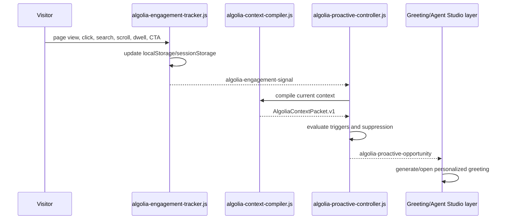

# Algolia Proactive Controller

## Purpose

The proactive controller decides when the concierge has earned the right to interrupt.

It does not write greeting copy, search Algolia, call Agent Studio, or open the chat with a hard-coded message. Its job is to read the visitor context packet, evaluate deterministic journey triggers, reserve one eligible opportunity, and emit a structured decision for the next layer.

Agent Studio owns the greeting language. The browser owns the timing.

## Runtime Files

| Layer | File | Responsibility |
|---|---|---|
| Collector | `frontend/chat-widget/algolia-engagement-tracker.js` | Captures page views, clicks, searches, scroll, dwell, CTA/form signals, persona selection, and chat interactions. |
| Compiler | `frontend/chat-widget/algolia-context-compiler.js` | Compiles tracker state into `AlgoliaContextPacket.v1` and Agent Studio `metadata.turnContext`. |
| Controller | `frontend/chat-widget/algolia-proactive-controller.js` | Evaluates trigger grammar and emits `algolia-proactive-opportunity`. |
| Engage shell | `frontend/chat-widget/algolia-chat-engage.js` | Visual acknowledgement and existing widget integration. |

## Storage Contract

The controller reads existing tracker/compiler state and writes only its own opportunity state.

| Key | Storage | Owner | Notes |
|---|---|---|---|
| `algolia_profile` | `localStorage` | Tracker | Visitor-level profile such as selected persona. Survives refreshes. |
| `algolia_session` | `sessionStorage` | Tracker | Current session pages, dwell, scroll, and engagement history. |
| `algolia_events` | `sessionStorage` | Tracker | Bounded event stream for this browser tab session. |
| `algolia_proactive_state` | `sessionStorage` | Controller | Reserved proactive opportunities and cooldown state. |

## Trigger Grammar

The controller evaluates candidates in priority order and selects the highest eligible trigger.

| Moment | Trigger | Condition | Priority | Message goal |
|---|---|---|---:|---|
| Commercial evaluation | `product_to_pricing` | Current page is pricing/demo/contact and a prior session page was product. | 88 | `explain_cost_drivers` |
| Commercial evaluation | `implementation_to_pricing` | Current page is pricing/demo/contact and a prior page was developer/docs. | 86 | `connect_implementation_effort_to_cost` |
| Implementation research | `pricing_to_implementation` | Current page is developer/docs and a prior page was pricing/demo/contact. | 84 | `reduce_implementation_uncertainty` |
| Customer proof | `product_to_customer_story` | Current page is a customer story and a prior page was product. | 82 | `surface_relevant_customer_proof` |
| Implementation research | `search_to_docs` | Current page is developer/docs and recent site search included implementation terms. | 80 | `answer_implementation_path` |
| Commercial evaluation | `pricing_8s_dwell` | Current page is pricing/demo/contact with at least 8 seconds dwell. | 78 | `explain_cost_drivers` |
| Implementation research | `developer_page_15s_dwell` | Current page is developer/docs with at least 15 seconds dwell. | 76 | `reduce_implementation_uncertainty` |
| Implementation research | `developer_page_60_scroll` | Current page is developer/docs with at least 60% scroll. | 74 | `reduce_implementation_uncertainty` |
| Customer proof | `customer_story_12s_dwell` | Current page is a customer story with at least 12 seconds dwell. | 72 | `surface_relevant_customer_proof` |
| Customer proof | `customer_story_60_scroll` | Current page is a customer story with at least 60% scroll. | 70 | `surface_relevant_customer_proof` |
| Product research | `product_page_10s_dwell` | Current page is product with at least 10 seconds dwell. | 66 | `explain_product_fit` |
| Product research | `product_page_50_scroll` | Current page is product with at least 50% scroll. | 64 | `explain_product_fit` |
| Journey shift | `multiple_product_pages` | Session includes at least two product pages. | 62 | `help_compare_capabilities` |

Hover is not a proactive trigger. Hover can help the UI expose menus, but it is too weak to infer intent or open a concierge message.

## Suppression Rules

An eligible trigger is suppressed when:

| Reason | Meaning |
|---|---|
| `disabled` | Controller config disables proactive engagement. |
| `missing_context_packet` | The context compiler is not available. |
| `no_trigger_match` | No trigger matched the current packet. |
| `chat_already_open` | The visitor recently opened the chat. |
| `page_hidden` | The browser page is not visible. |
| `auto_engage_disabled` | The chat component explicitly disables auto engagement. |
| `session_cap_reached` | The session already used the configured opportunity cap. |
| `cooldown_active` | A prior opportunity was reserved too recently. |
| `already_eligible_for_page_moment` | The same page and moment already has an active opportunity. |

Defaults:

```json
{
  "maxOpportunitiesPerSession": 3,
  "cooldownMs": 120000,
  "productDwellMs": 10000,
  "productScrollDepth": 50,
  "implementationDwellMs": 15000,
  "implementationScrollDepth": 60,
  "pricingDwellMs": 8000,
  "customerProofDwellMs": 12000,
  "customerProofScrollDepth": 60
}
```

## Decision Packet

When a trigger is eligible, the controller emits:

```json
{
  "schema": "AlgoliaProactiveDecision.v1",
  "engage": true,
  "moment": "commercial_evaluation",
  "trigger": "product_to_pricing",
  "priority": 88,
  "messageGoal": "explain_cost_drivers",
  "reasonCodes": ["journey_product_to_pricing", "pricing_page_view"],
  "agentPromptPacket": {
    "moment": "commercial_evaluation",
    "trigger": "product_to_pricing",
    "persona": "developer",
    "currentPage": {},
    "journey": [],
    "observedSignals": [],
    "inferredIntent": {},
    "friction": {},
    "messageGoal": "explain_cost_drivers",
    "tone": "sharp, useful, warm, lightly witty",
    "constraints": {
      "maxWords": 34,
      "noTelemetryExposure": true,
      "includeQuestionChips": true
    }
  }
}
```

Downstream greeting generation should use this packet as input. The greeting must never expose raw telemetry such as “I saw you click X.” It should translate the moment into useful concierge help.

## Event Flow



## Build Boundary

This module is complete when it can deterministically emit or suppress proactive opportunities from real tracker/compiler state. The next module consumes `algolia-proactive-opportunity`, asks Agent Studio for the greeting, and opens the chat with that returned greeting.
