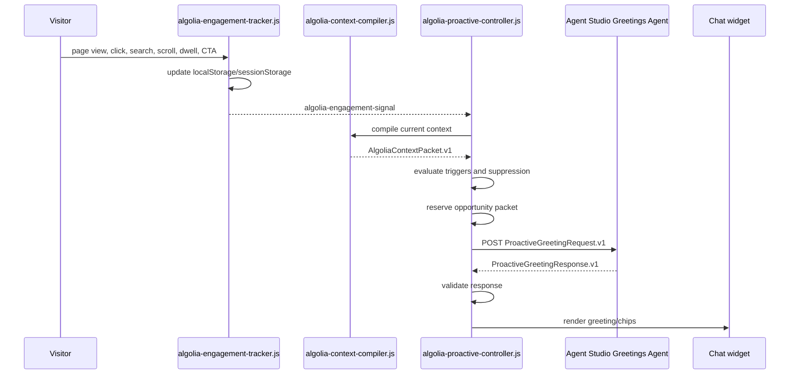

# Algolia Proactive Controller

## Purpose

The proactive controller decides when the concierge has earned the right to interrupt, sends the qualified opportunity packet to the Agent Studio Greetings Agent, and renders the returned greeting.

It does not write greeting copy, search Algolia, or call the main orchestrator. Its job is to read the visitor context packet, evaluate deterministic journey triggers, reserve one eligible opportunity, POST the packet to the Greetings Agent, validate the greeting response, and open the widget with that returned greeting.

Agent Studio owns the greeting language. The browser owns the timing, validation, and rendering.

## Runtime Files

| Layer | File | Responsibility |
|---|---|---|
| Collector | `frontend/chat-widget/algolia-engagement-tracker.js` | Captures page views, clicks, searches, scroll, dwell, CTA/form signals, persona selection, and chat interactions. |
| Compiler | `frontend/chat-widget/algolia-context-compiler.js` | Compiles tracker state into `AlgoliaContextPacket.v1` and Agent Studio `metadata.turnContext`. |
| Controller | `frontend/chat-widget/algolia-proactive-controller.js` | Evaluates trigger grammar, stores opportunity packets, POSTs to the Greetings Agent, validates its response, and opens the widget. |
| Handoff client tool | `frontend/chat-widget/handoff-to-orchestrator.js` | Executes `handoff_to_orchestrator` after the visitor engages and POSTs the engaged turn to the main orchestrator. |
| Engage shell | `frontend/chat-widget/algolia-chat-engage.js` | Visual acknowledgement and existing widget integration. |

## Storage Contract

The controller reads existing tracker/compiler state and writes only its own opportunity state.

| Key | Storage | Owner | Notes |
|---|---|---|---|
| `algolia_profile` | `localStorage` | Tracker | Visitor-level profile such as selected persona. Survives refreshes. |
| `algolia_session` | `sessionStorage` | Tracker | Current session pages, dwell, scroll, and engagement history. |
| `algolia_events` | `sessionStorage` | Tracker | Bounded event stream for this browser tab session. |
| `algolia_proactive_state` | `sessionStorage` | Controller | Reserved proactive opportunities and cooldown state. |

## Trigger Grammar

The controller evaluates candidates in priority order and selects the highest eligible trigger.

| Moment | Trigger | Condition | Priority | Message goal |
|---|---|---|---:|---|
| Commercial evaluation | `product_to_pricing` | Current page is pricing/demo/contact and a prior session page was product. | 88 | `explain_cost_drivers` |
| Commercial evaluation | `implementation_to_pricing` | Current page is pricing/demo/contact and a prior page was developer/docs. | 86 | `connect_implementation_effort_to_cost` |
| Implementation research | `pricing_to_implementation` | Current page is developer/docs and a prior page was pricing/demo/contact. | 84 | `reduce_implementation_uncertainty` |
| Customer proof | `product_to_customer_story` | Current page is a customer story and a prior page was product. | 82 | `surface_relevant_customer_proof` |
| Implementation research | `search_to_docs` | Current page is developer/docs and recent site search included implementation terms. | 80 | `answer_implementation_path` |
| Commercial evaluation | `pricing_8s_dwell` | Current page is pricing/demo/contact with at least 8 seconds dwell. | 78 | `explain_cost_drivers` |
| Implementation research | `developer_page_15s_dwell` | Current page is developer/docs with at least 15 seconds dwell. | 76 | `reduce_implementation_uncertainty` |
| Implementation research | `developer_page_60_scroll` | Current page is developer/docs with at least 60% scroll. | 74 | `reduce_implementation_uncertainty` |
| Customer proof | `customer_story_12s_dwell` | Current page is a customer story with at least 12 seconds dwell. | 72 | `surface_relevant_customer_proof` |
| Customer proof | `customer_story_60_scroll` | Current page is a customer story with at least 60% scroll. | 70 | `surface_relevant_customer_proof` |
| Product research | `product_page_10s_dwell` | Current page is product with at least 10 seconds dwell. | 66 | `explain_product_fit` |
| Product research | `product_page_50_scroll` | Current page is product with at least 50% scroll. | 64 | `explain_product_fit` |
| Journey shift | `multiple_product_pages` | Session includes at least two product pages. | 62 | `help_compare_capabilities` |

Hover is not a proactive trigger. Hover can help the UI expose menus, but it is too weak to infer intent or open a concierge message.

## Suppression Rules

An eligible trigger is suppressed when:

| Reason | Meaning |
|---|---|
| `disabled` | Controller config disables proactive engagement. |
| `missing_context_packet` | The context compiler is not available. |
| `no_trigger_match` | No trigger matched the current packet. |
| `chat_already_open` | The visitor recently opened the chat. |
| `page_hidden` | The browser page is not visible. |
| `auto_engage_disabled` | The chat component explicitly disables auto engagement. |
| `session_cap_reached` | The session already used the configured opportunity cap. |
| `cooldown_active` | A prior opportunity was reserved too recently. |
| `already_eligible_for_page_moment` | The same page and moment already has an active opportunity. |

Defaults:

```json
{
  "maxOpportunitiesPerSession": 3,
  "cooldownMs": 120000,
  "productDwellMs": 10000,
  "productScrollDepth": 50,
  "implementationDwellMs": 15000,
  "implementationScrollDepth": 60,
  "pricingDwellMs": 8000,
  "customerProofDwellMs": 12000,
  "customerProofScrollDepth": 60
}
```

Greetings Agent configuration:

```js
window.ALGOLIA_PROACTIVE_CONFIG = {
  greetingsAgentId: "<Agent Studio Greetings Agent ID>",
  appId: "0EXRPAXB56",
  apiKey: "<search-only key>",
  compatibilityMode: "ai-sdk-5",
  cache: false,
  memory: false
};
```

On the Jahia demo surface, the controller also accepts the existing
`window.ALGOLIA_CONTEXT_ENGINE_CONFIG.conciergeAgentId` written by
`<algolia-chat-engage concierge-agent-id="...">` as a fallback Greetings Agent ID.
This keeps the v1 deployment from needing a second inline config block.

## Decision Packet

When a trigger is eligible, the controller generates an `opportunityId` and builds:

```json
{
  "schema": "AlgoliaProactiveDecision.v1",
  "engage": true,
  "opportunityId": "opp_19fff074c5d_23ee98",
  "moment": "commercial_evaluation",
  "trigger": "product_to_pricing",
  "priority": 88,
  "messageGoal": "explain_cost_drivers",
  "reasonCodes": ["journey_product_to_pricing", "pricing_page_view"],
  "agentPromptPacket": {
    "schema": "ProactiveGreetingRequest.v1",
    "opportunityId": "opp_19fff074c5d_23ee98",
    "moment": "commercial_evaluation",
    "trigger": "product_to_pricing",
    "priority": 88,
    "persona": "developer",
    "currentPage": {},
    "journey": [],
    "observedSignals": [],
    "inferredIntent": {},
    "friction": {},
    "messageGoal": "explain_cost_drivers",
    "tone": "sharp, useful, warm, lightly witty",
    "constraints": {
      "maxWords": 34,
      "noTelemetryExposure": true,
      "includeQuestionChips": true
    }
  }
}
```

Downstream greeting generation should use this packet as input. The greeting must never expose raw telemetry such as “I saw you click X.” It should translate the moment into useful concierge help.

The full `agentPromptPacket` is stored in `sessionStorage.algolia_proactive_state` under the generated `opportunityId`. `handoff-to-orchestrator.js` later reads the same packet for downstream orchestrator handoff.

## Greetings Agent Call

After reserving an eligible opportunity, the controller calls the Agent Studio Greetings Agent directly.

POST:

```text
https://{appId}.algolia.net/agent-studio/1/agents/{greetingsAgentId}/completions?compatibilityMode=ai-sdk-5&stream=false&cache=false&memory=false
```

Body:

```json
{
  "id": "alg_cnv_proactive_opp_19fff074c5d_23ee98",
  "messages": [
    {
      "id": "alg_msg_proactive_opp_19fff074c5d_23ee98",
      "role": "user",
      "parts": [
        {
          "type": "text",
          "text": "PROACTIVE_GREETING_REQUEST\n{...ProactiveGreetingRequest.v1...}"
        }
      ],
      "metadata": {
        "turnContext": {
          "schema": "AlgoliaTurnContext.v1"
        }
      }
    }
  ]
}
```

The controller expects strict JSON from the Greetings Agent:

```json
{
  "schema": "ProactiveGreetingResponse.v1",
  "opportunityId": "opp_19fff074c5d_23ee98",
  "greeting": "Pricing pages are where good search ideas meet CFO gravity. Want the practical version of what actually drives cost?",
  "chips": ["What drives cost?", "How are API calls counted?", "Which plan fits?"],
  "handoffSummary": {
    "moment": "commercial_evaluation",
    "trigger": "product_to_pricing",
    "messageGoal": "explain_cost_drivers"
  }
}
```

The JSON is not shown to the visitor. It is a browser/controller contract. The visitor sees only `greeting` and clickable chips.

The controller accepts either:

- plain JSON text;
- Agent Studio streamed text deltas that reconstruct the same JSON.

Validation gates:

- `schema` equals `ProactiveGreetingResponse.v1`.
- `opportunityId` matches the reserved opportunity.
- `greeting` is 12-34 words.
- `chips` has 0-3 items and each chip is 8 words or fewer.
- `handoffSummary` matches the reserved opportunity.
- Greeting does not expose telemetry or raw behavior.
- Greeting does not include unsupported pricing values, customer metrics, roadmap claims, links, or hidden/internal language.

On pass, the controller calls:

```js
document.querySelector("algolia-chat")?.engage({
  greeting,
  suggestions: chips
});
```

The widget API currently names the clickable chips `suggestions`; project docs and prompts call them `chips`. The mapping happens only at this widget API boundary.

On fail, the controller does not open the widget.

## Event Flow



## Build Boundary

This module is complete when it can deterministically emit or suppress proactive opportunities from real tracker/compiler state, call the Greetings Agent, validate the returned greeting, and open the chat with that returned greeting.

## Tests

Runtime tests prove:

- all deterministic trigger permutations still work;
- hover-only activity never triggers proactive engagement;
- the controller POSTs `ProactiveGreetingRequest.v1` to the configured Greetings Agent;
- `metadata.turnContext` is attached to the completion request;
- valid `ProactiveGreetingResponse.v1` renders in the widget;
- `chips` map to the existing widget API's `suggestions`;
- invalid or telemetry-exposing greetings are rejected;
- streamed Agent Studio text deltas are parsed.
