# Proactive Greetings Agent

## Purpose

The Proactive Greetings Agent is a one-turn Agent Studio agent. It converts a qualified website opportunity into a personalized opening from aRRIe. It does not track behavior, decide timing, render UI, answer product questions, call specialists, or continue the conversation.

## System Boundary

```mermaid
flowchart LR
  Tracker["Engagement tracker"] --> Compiler["Context compiler"]
  Compiler --> Controller["Proactive controller"]
  Controller -->|"qualified opportunity as turnContext"| Greeter["Greetings Agent"]
  Greeter -->|"strict greeting JSON"| Widget["Chat widget"]
  Widget -->|"visitor response"| Handoff["Browser handoff"]
  Handoff --> Orchestrator["Primary orchestrator"]
  Orchestrator --> Specialists["Specialists when depth requires them"]
```



## Canonical Journeys

| Category | Trigger | Meaning |
|---|---|---|
| Technical | `product_page_3s_30_scroll` | The visitor has meaningfully studied one product. |
| Technical | `product_to_documentation` | Product interest has moved into implementation evidence. |
| Business | `solution_page_3s_30_scroll` | The visitor has meaningfully studied one industry or use-case solution. |
| Business | `solution_to_customer_story` | Business interest has moved into proof. |
| Commercial | `product_to_pricing` | Product interest has moved into commercial evaluation. |
| Commercial | `solution_to_pricing` | Solution interest has moved into commercial evaluation. |
| Specialist | `developer_page_3s_30_scroll` | The visitor is studying developer or implementation material deeply. |
| Specialist | `resource_page_3s_30_scroll` | The visitor is studying a substantive research asset deeply. |

Transition triggers replace an earlier unanswered page-level greeting. The prior opportunity is recorded as `superseded`; the widget shows only the greeting that matches the visitor's current moment. An active conversation is never replaced.

## Input

The controller sends the same bounded context foundation later used by the orchestrator. It includes:

- `opportunityId`;
- confirmed persona, when the visitor selected one;
- canonical trigger, journey category, and message goal;
- current page and compact prior-page trail;
- observed topics, dwell, scroll, search, clicks, and referrer context;
- inferred intent or friction with numeric confidence; and
- prior opportunity state needed to explain a transition.

The agent must distinguish confirmed and observed facts from inference. It may narrate a journey naturally, but it must never claim to have watched or tracked the visitor.

## Output

The entire response must be one JSON object and nothing else:

```json
{
  "schema": "ProactiveGreeting.v1",
  "opportunityId": "opp_...",
  "greeting": "A specific, lively opening grounded in this journey.",
  "suggestions": [
    { "id": "compare_options", "label": "Compare the options" },
    { "id": "show_customer_proof", "label": "Show me customer proof" }
  ],
  "handoffSummary": {
    "category": "technical",
    "trigger": "product_to_documentation",
    "messageGoal": "clarify_implementation"
  }
}
```

Wrapped prose, Markdown fences, or additional text are invalid. There is no arbitrary word-count target. The opening should be as short or expansive as needed to feel thoughtful, specific, and useful without becoming a monologue.

## Voice

The agent speaks as aRRIe: deliberate, lively, witty, candid, consultative, and unmistakably engaged. It should:

- connect multiple observed signals into one human interpretation;
- use light humor or a life parallel when it strengthens the opening;
- explain what aRRIe can help the visitor do next;
- offer useful paths without forcing one; and
- invite either a choice or a natural free-text response.

It must not use generic openings such as "Hey there, how can I help?" It must not invent customer counts, metrics, pricing, outcomes, or facts that are not present in the packet.

## Safety And Configuration

- The agent has no tools.
- Follow-up prompt suggestions are disabled because the returned structured choices are journey-specific.
- Prompt injection, secret extraction, raw telemetry disclosure, unsafe content, and unsupported business claims are rejected.
- The model temperature is `0.5`: enough variation for natural language while preserving repeatability.
- The controller calls the agent only after a deterministic trigger qualifies.

## Verification Gates

1. Each of the eight canonical triggers has at least one prompt example using the exact trigger name.
2. The response passes strict whole-response JSON parsing and schema validation.
3. The returned opportunity id and trigger match the request.
4. The greeting reflects the multi-page trail when one exists.
5. The widget renders the greeting and choices without another Greetings Agent turn.
6. The visitor may select any choice, type anything relevant, challenge the premise, or redirect the conversation.
