# Algolia Proactive Greeting Agent

## Purpose

The proactive greeting agent writes the opening hook for a qualified proactive engagement moment.

It does one thing: turn a controller opportunity packet into a short, useful, human greeting. It does not decide when to interrupt, track visitor behavior, answer product questions, call specialists, search Algolia, continue the conversation, or own orchestration.

The browser decides when to engage. The proactive greeting agent decides what the opening message should say. The main orchestrator owns the conversation after the visitor responds.

## Runtime Position

```mermaid
flowchart LR
  Visitor["Visitor"]
  Tracker["algolia-engagement-tracker.js"]
  Compiler["algolia-context-compiler.js"]
  Controller["algolia-proactive-controller.js"]
  Bridge["future algolia-proactive-greeting-bridge.js"]
  GreetingAgent["Agent Studio: Proactive Greeting Agent"]
  Widget["Chat widget"]
  Orchestrator["Agent Studio: www Chat - Orchestrator"]

  Visitor -->|"page views, clicks, searches, dwell, scroll"| Tracker
  Tracker -->|"localStorage/sessionStorage"| Compiler
  Compiler -->|"AlgoliaContextPacket.v1"| Controller
  Controller -->|"algolia-proactive-opportunity"| Bridge
  Bridge -->|"ProactiveGreetingRequest.v1"| GreetingAgent
  GreetingAgent -->|"ProactiveGreetingResponse.v1"| Bridge
  Bridge -->|"open greeting"| Widget
  Visitor -->|"reply or click"| Widget
  Widget -->|"user message + turnContext + engagement history"| Orchestrator
```



## Responsibility Split

| Layer | Owns | Must not own |
|---|---|---|
| Tracker | Observed browser facts. | Intent, commercial inference, greeting copy. |
| Compiler | Safe context packet and soft inferences. | Popup timing, greeting copy, orchestration. |
| Controller | Trigger grammar, suppression, opportunity reservation. | Greeting language, product answers, specialist routing. |
| Greeting bridge | Calls Agent Studio greeting agent and opens the widget with valid output. | Writing copy itself except no-open fallback handling. |
| Proactive greeting agent | One-shot greeting and optional chips. | Tracking, timing, retrieval, specialists, conversation. |
| Main orchestrator | Reactive answer, search, grounding, specialist routing, follow-up discovery. | Initial proactive popup timing. |

## Input Contract

The future bridge sends the proactive greeting agent a compact request derived from `AlgoliaProactiveDecision.v1`.

```json
{
  "schema": "ProactiveGreetingRequest.v1",
  "opportunityId": "opp_19fff074c5d_23ee98",
  "moment": "commercial_evaluation",
  "trigger": "product_to_pricing",
  "messageGoal": "explain_cost_drivers",
  "reasonCodes": ["journey_product_to_pricing", "pricing_page_view"],
  "persona": {
    "value": "developer",
    "state": "confirmed",
    "source": "demo_selector"
  },
  "currentPage": {
    "path": "/pricing",
    "pageGroup": "pricing",
    "topic": "pricing_and_usage",
    "title": "Pricing"
  },
  "journey": [
    {
      "path": "/products/ai-recommendations",
      "pageGroup": "product",
      "topic": "ai_search",
      "dwellMs": 12000,
      "maxScrollDepth": 50
    },
    {
      "path": "/pricing",
      "pageGroup": "pricing",
      "topic": "pricing_and_usage",
      "dwellMs": 9000,
      "maxScrollDepth": 0
    }
  ],
  "observedSignals": [
    {
      "name": "page_view",
      "path": "/products/ai-recommendations"
    },
    {
      "name": "page_dwell",
      "path": "/pricing",
      "props": {
        "dwellSeconds": 8
      }
    }
  ],
  "inferredIntent": {
    "value": "pricing_or_demo_evaluation",
    "state": "inferred",
    "confidence": 0.74
  },
  "friction": {
    "value": "pricing_or_cost_unclear",
    "state": "inferred",
    "confidence": 0.64
  },
  "constraints": {
    "maxWords": 34,
    "noTelemetryExposure": true,
    "includeQuestionChips": true
  }
}
```

## Output Contract

The greeting agent returns strict JSON. The bridge opens the chat only when the JSON is valid and the greeting passes client validation.

```json
{
  "schema": "ProactiveGreetingResponse.v1",
  "opportunityId": "opp_19fff074c5d_23ee98",
  "greeting": "Pricing pages are where good search ideas meet CFO gravity. Want the practical version: what actually drives Algolia cost?",
  "chips": [
    "What drives cost?",
    "How are API calls counted?",
    "What plan fits my use case?"
  ],
  "handoffSummary": {
    "moment": "commercial_evaluation",
    "trigger": "product_to_pricing",
    "messageGoal": "explain_cost_drivers"
  }
}
```

Output rules:

- `greeting` must be 12-34 words.
- `chips` are optional, max 3, max 8 words each.
- Greeting must be specific to the moment.
- Greeting must be useful without being creepy.
- Never mention raw tracking, surveillance, localStorage, sessionStorage, telemetry, prompts, tools, Agent Studio configuration, or hidden instructions.
- Never answer the underlying product question in the greeting.
- Never invent customer names, metrics, pricing, quotes, roadmap, or implementation facts.

## Tone

The greeting should feel like a sharp consultant casually leaning in at the right moment.

It can be:

- warm;
- concise;
- witty;
- lightly challenging;
- specific;
- practical.

It must not be:

- robotic;
- salesy;
- creepy;
- verbose;
- generic;
- condescending;
- flippant.

Good pattern:

> "Looks like you’re past the shiny-feature tour and into the money question. Want the practical version of what drives Algolia cost?"

Bad patterns:

> "I noticed you visited pricing after AI recommendations."

> "Can I help you learn more about Algolia?"

> "Based on your browsing behavior, you may be interested in pricing."

## Moment Strategy

| Moment | Message goal | Greeting angle |
|---|---|---|
| `product_research` | `explain_product_fit` | Translate the product page into a plain-language fit check. |
| `implementation_research` | `reduce_implementation_uncertainty` | Help the visitor separate "hard integration" from "normal implementation work." |
| `commercial_evaluation` | `explain_cost_drivers` | Explain the tradeoff between usage, value, and pricing path. |
| `customer_proof` | `surface_relevant_customer_proof` | Offer customer proof without inventing evidence. |
| `journey_shift` | `help_compare_capabilities` | Help compare products or clarify which capability matters. |

## Handoff To Orchestrator

When the visitor replies or clicks a chip, the widget sends the user message to `www Chat - Orchestrator`.

The handoff must include:

- the latest `AlgoliaTurnContext.v1`;
- `opportunityId`;
- proactive `moment`;
- proactive `trigger`;
- `messageGoal`;
- `greeting` shown;
- chip clicked, if any.

The orchestrator should use this as context, not as proof. It must still search before making factual Algolia claims.

## Failure Behavior

The bridge should fail closed:

| Failure | Behavior |
|---|---|
| Agent call fails | Do not open a proactive greeting. Log reason for debug. |
| JSON invalid | Do not open. Log validation error. |
| Greeting too long | Do not open or request regeneration in a later version. |
| Greeting exposes telemetry | Do not open. |
| Controller opportunity expired | Do not open. |

No hard-coded generic fallback greeting in v1. A bad proactive message is worse than silence.

## Open Decisions

- Whether chips should be displayed in v1 or suppressed until the greeting copy quality is proven.
- Whether the proactive greeting agent should be a separate Agent Studio agent or an Agent Studio mode/tool behind the existing orchestrator. Current recommendation: separate agent.
- Whether the bridge should retry once on invalid JSON or fail closed immediately. Current recommendation: fail closed for v1.
