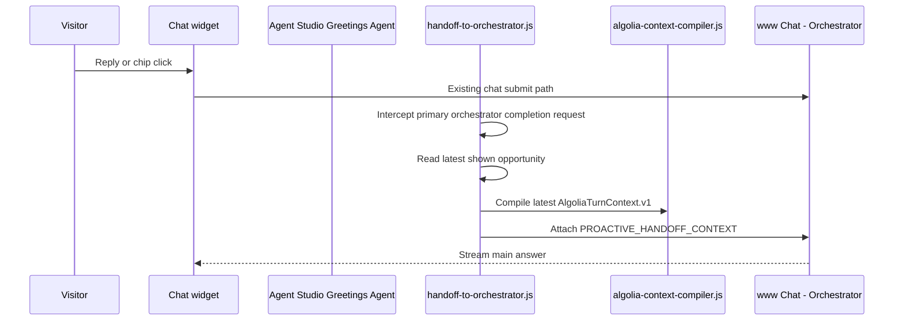

# Handoff To Orchestrator JavaScript Client Tool

## Purpose

This document is the build spec for `frontend/chat-widget/handoff-to-orchestrator.js`, the JavaScript file that executes the Greetings Agent's `handoff_to_orchestrator` client-side tool.

It carries the first engaged proactive user turn to `www Chat - Orchestrator` with the original opportunity packet, latest compiled context, greeting shown, chips, and user reply or selected chip.

The tool does not generate copy, decide triggers, or answer the visitor. It is transport and validation.

## Position In Flow



The Agent Studio tool schema still exists on the Greetings Agent so a native `handoff_to_orchestrator` tool call can be supported when the widget routes an engaged response back through the Greeting Agent. The deployed v1 path also decorates the next primary orchestrator request because the current chat widget owns the visible conversation with the primary orchestrator.

## Agent Studio Tool Schema

Tool name: `handoff_to_orchestrator`

Agent Studio's dashboard follows the function-calling pattern, but the management API stores client-side tools with `type: "client_side"` and `inputSchema`:

```json
{
  "name": "handoff_to_orchestrator",
  "type": "client_side",
  "description": "Hands an engaged proactive visitor to the main Algolia.com orchestrator. Use only after PROACTIVE_USER_ENGAGEMENT. Do not answer the visitor yourself.",
  "inputSchema": {
    "type": "object",
    "properties": {
      "schema": { "type": "string", "enum": ["ProactiveHandoffToolInput.v1"] },
      "opportunityId": { "type": "string" },
      "greeting": { "type": "string" },
      "chips": { "type": "array", "items": { "type": "string" }, "maxItems": 3 },
      "selectedChip": { "type": ["string", "null"] },
      "userResponse": { "type": "string" },
      "handoffSummary": {
        "type": "object",
        "properties": {
          "moment": { "type": "string" },
          "trigger": { "type": "string" },
          "messageGoal": { "type": "string" }
        },
        "required": ["moment", "trigger", "messageGoal"],
        "additionalProperties": false
      }
    },
    "required": ["schema", "opportunityId", "greeting", "chips", "selectedChip", "userResponse", "handoffSummary"],
    "additionalProperties": false
  }
}
```

## Runtime Input

The model passes the interaction fields. The JavaScript adds the trusted browser-owned fields:

- original `AlgoliaProactiveDecision.v1` from session storage;
- latest `AlgoliaContextPacket.v1`;
- latest flat `AlgoliaTurnContext.v1`;
- engagement history;
- source URL/path metadata;
- conversation IDs and message IDs.

This is deliberate. The model should not be trusted to echo the original opportunity packet perfectly.

## Orchestrator Completion Decoration

The current implementation does not create a separate orchestrator POST. It decorates the existing widget POST to the primary orchestrator:

```text
https://{appId}.algolia.net/agent-studio/1/agents/{orchestratorAgentId}/completions?compatibilityMode=ai-sdk-5&stream=true&cache=false
```

Body:

```json
{
  "id": "alg_cnv_orch_...",
  "messages": [
    {
      "id": "alg_msg_handoff_...",
      "role": "user",
      "parts": [
        {
          "type": "text",
          "text": "How are API calls counted?\n\nPROACTIVE_HANDOFF_CONTEXT\n{\"schema\":\"ProactiveHandoffContext.v1\",\"opportunityId\":\"opp_...\",\"userResponse\":\"How are API calls counted?\",\"selectedChip\":\"How are API calls counted?\",\"greeting\":\"Pricing pages are where shiny ideas meet budget gravity...\",\"chips\":[\"Break down cost drivers\",\"API calls and usage\",\"Which plan fits?\"],\"handoffSummary\":{\"moment\":\"commercial_evaluation\",\"trigger\":\"product_to_pricing\",\"messageGoal\":\"explain_cost_drivers\"},\"requestPacket\":{},\"contextPacket\":{}}"
        }
      ],
      "metadata": {
        "turnContext": {
          "schema": "AlgoliaTurnContext.v1"
        }
      }
    }
  ]
}
```

The visible user text remains the visitor's message. The appended `PROACTIVE_HANDOFF_CONTEXT` is an internal instruction block for the orchestrator; the orchestrator must never quote or expose it.

## Validation Gates

- `opportunityId` exists in session storage and is not expired.
- `handoffSummary` matches the stored opportunity.
- `userMessage` is present and under the configured max length.
- `greetingShown` matches the rendered greeting or stored greeting record.
- Latest `AlgoliaTurnContext.v1` compiles successfully.
- Orchestrator config has app ID, search API key, and orchestrator agent ID.
- Completion response starts streaming or returns a structured error.

## Failure Behavior

| Failure | Behavior |
|---|---|
| Missing opportunity | Return `{ success:false, error:{ code:"OPPORTUNITY_NOT_FOUND" } }`. |
| Invalid args | Return validation error; do not call orchestrator. |
| Orchestrator config missing | Return config error; keep user input in widget. |
| Orchestrator call fails | Return retry-safe error; do not clear handoff state. |
| Stream interrupted | Preserve partial response and expose retry. |

## Tests

Unit tests must prove:

- It registers a valid `handoff_to_orchestrator` handler.
- It reads the original opportunity packet from session storage.
- It attaches latest `AlgoliaTurnContext.v1`.
- It decorates only primary orchestrator completion requests.
- It does not decorate unrelated agent requests.
- It marks the opportunity as `handoff_sent` after decoration.

## Documentation Evidence

This design follows Algolia Agent Studio's client-side tool pattern: the agent defines a function schema, the frontend code executes the function in the browser context, and the code returns structured tool output to the agent.
