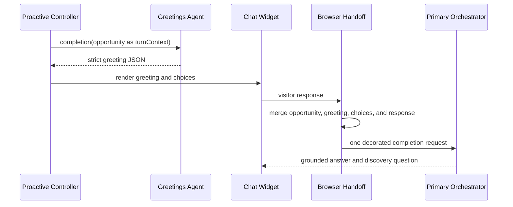

# Proactive Handoff To Orchestrator

## Purpose

`frontend/chat-widget/handoff-to-orchestrator.js` preserves the proactive journey when the visitor responds to a greeting. It is browser runtime code, not an Agent Studio tool and not a second agent turn.

The Greetings Agent has one job: generate one greeting and its response choices. The browser renders that result. When the visitor clicks a choice or types freely, the existing chat submission path sends one request to the primary orchestrator with the handoff context attached.

## Runtime Sequence

## Input

The browser combines:

- the stored `ProactiveOpportunity.v1` packet;
- the exact greeting returned by the Greetings Agent;
- all rendered choices;
- the selected choice, when applicable;
- the visitor's free-text response, when applicable; and
- the compiled `AlgoliaContextPacket.v1` journey context.

The visitor response is authoritative. A choice helps structure intent but never restricts what the visitor may ask.

## Output Contract

The outgoing primary-orchestrator turn contains the visitor's response plus one `PROACTIVE_HANDOFF_CONTEXT` object. The compiler validates the final merged per-turn context after all handoff fields have been added:

- at most 32 top-level keys;
- at most 4,096 UTF-8 bytes in total; and
- at most 1,024 UTF-8 bytes per value.

There is no independent 6,500-character clipping rule. If the valid Agent Studio context budget cannot be met, the request fails closed with an explicit trace rather than silently truncating meaning.

## State Machine

| State | Meaning |
|---|---|
| `shown` | Greeting is visible and can receive a response. |
| `handoff_pending` | Visitor responded; the orchestrator request is in flight. |
| `handoff_sent` | The orchestrator accepted the decorated request. |

Network or HTTP failure restores `shown` so the visitor can retry. A transition opportunity never consumes the previous opportunity until its greeting has actually rendered.

## Ownership Rules

- The controller decides when an opportunity exists.
- The Greetings Agent writes one greeting; it does not continue the conversation.
- The widget renders UI and captures the visitor response.
- The browser handoff decorates the existing submission request.
- The primary orchestrator owns every conversational answer after engagement.
- Agent Studio specialists are called only by the primary orchestrator.

## Verification Gates

1. The Greetings Agent receives exactly one completion call per rendered opportunity.
2. No `PROACTIVE_USER_ENGAGEMENT` turn is sent back to the Greetings Agent.
3. The primary orchestrator receives the greeting, choices, visitor response, opportunity, and compiled context together.
4. A failed request remains retryable and does not mark the opportunity sent.
5. A successful request records `handoff_sent` and preserves conversation continuity across navigation.
