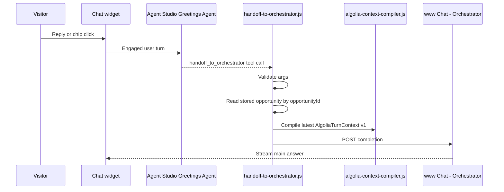

# Handoff To Orchestrator Client Tool

## Purpose

`handoff-to-orchestrator.js` executes the Greetings Agent's `handoff_to_orchestrator` client-side tool.

It forwards the first engaged proactive user turn to `www Chat - Orchestrator` with the original opportunity packet, latest compiled context, greeting shown, and user reply or selected chip.

The tool does not generate copy, decide triggers, or answer the visitor. It is transport and validation.

## Position In Flow



## Agent Studio Tool Schema

Tool name: `handoff_to_orchestrator`

Strict JSON schema:

```json
{
  "type": "function",
  "function": {
    "name": "handoff_to_orchestrator",
    "description": "Forward the visitor's first engaged proactive reply to the main Algolia.com orchestrator. Use this after the visitor replies to a proactive greeting or clicks one of its chips. Do not answer the visitor yourself.",
    "strict": true,
    "parameters": {
      "type": "object",
      "properties": {
        "schema": {
          "type": "string",
          "enum": ["HandoffToOrchestrator.v1"]
        },
        "opportunityId": {
          "type": "string",
          "description": "The proactive opportunity identifier from the original greeting request."
        },
        "userMessage": {
          "type": "string",
          "description": "The visitor's exact typed reply or clicked chip text."
        },
        "selectedChip": {
          "type": ["string", "null"],
          "description": "The chip text if a chip was clicked, otherwise null."
        },
        "greetingShown": {
          "type": "string",
          "description": "The exact proactive greeting shown to the visitor."
        },
        "handoffSummary": {
          "type": "object",
          "properties": {
            "moment": { "type": "string" },
            "trigger": { "type": "string" },
            "messageGoal": { "type": "string" }
          },
          "required": ["moment", "trigger", "messageGoal"],
          "additionalProperties": false
        }
      },
      "required": [
        "schema",
        "opportunityId",
        "userMessage",
        "selectedChip",
        "greetingShown",
        "handoffSummary"
      ],
      "additionalProperties": false
    }
  }
}
```

## Runtime Input

The model passes the interaction fields. The JavaScript adds the trusted browser-owned fields:

- original `AlgoliaProactiveDecision.v1` from session storage;
- latest `AlgoliaContextPacket.v1`;
- latest flat `AlgoliaTurnContext.v1`;
- engagement history;
- source URL/path metadata;
- conversation IDs and message IDs.

This is deliberate. The model should not be trusted to echo the original opportunity packet perfectly.

## Orchestrator Completion Request

POST:

```text
https://{appId}.algolia.net/agent-studio/1/agents/{orchestratorAgentId}/completions?compatibilityMode=ai-sdk-5&stream=true&cache=false
```

Body:

```json
{
  "id": "alg_cnv_orch_...",
  "messages": [
    {
      "id": "alg_msg_handoff_...",
      "role": "user",
      "parts": [
        {
          "type": "text",
          "text": "The visitor engaged with a proactive greeting.\n\nUser message:\nHow are API calls counted?\n\nGreeting shown:\nPricing pages are where good search ideas meet CFO gravity. Want the practical version of what actually drives cost?\n\nUse the hidden turn context and proactive handoff context. Answer the user directly."
        }
      ],
      "metadata": {
        "turnContext": {
          "schema": "AlgoliaTurnContext.v1"
        },
        "proactiveHandoff": {
          "schema": "AlgoliaProactiveHandoff.v1",
          "opportunityId": "opp_...",
          "moment": "commercial_evaluation",
          "trigger": "product_to_pricing",
          "messageGoal": "explain_cost_drivers",
          "selectedChip": "How are API calls counted?"
        }
      }
    }
  ]
}
```

The user-visible text must be natural and concise. Raw event arrays belong in metadata, not visible text.

## Validation Gates

- `opportunityId` exists in session storage and is not expired.
- `handoffSummary` matches the stored opportunity.
- `userMessage` is present and under the configured max length.
- `greetingShown` matches the rendered greeting or stored greeting record.
- Latest `AlgoliaTurnContext.v1` compiles successfully.
- Orchestrator config has app ID, search API key, and orchestrator agent ID.
- Completion response starts streaming or returns a structured error.

## Failure Behavior

| Failure | Behavior |
|---|---|
| Missing opportunity | Return `{ success:false, error:{ code:"OPPORTUNITY_NOT_FOUND" } }`. |
| Invalid args | Return validation error; do not call orchestrator. |
| Orchestrator config missing | Return config error; keep user input in widget. |
| Orchestrator call fails | Return retry-safe error; do not clear handoff state. |
| Stream interrupted | Preserve partial response and expose retry. |

## Tests

Unit tests must prove:

- It accepts a valid `handoff_to_orchestrator` call.
- It rejects mismatched `opportunityId` and `handoffSummary`.
- It reads the original opportunity packet from session storage.
- It attaches latest `AlgoliaTurnContext.v1`.
- It POSTs to the configured orchestrator endpoint.
- It does not expose raw telemetry in visible user text.
- It preserves user input on orchestrator failure.

## Documentation Evidence

This design follows Algolia Agent Studio's client-side tool pattern: the agent defines a function schema, the frontend code executes the function in the browser context, and the code returns structured tool output to the agent.
